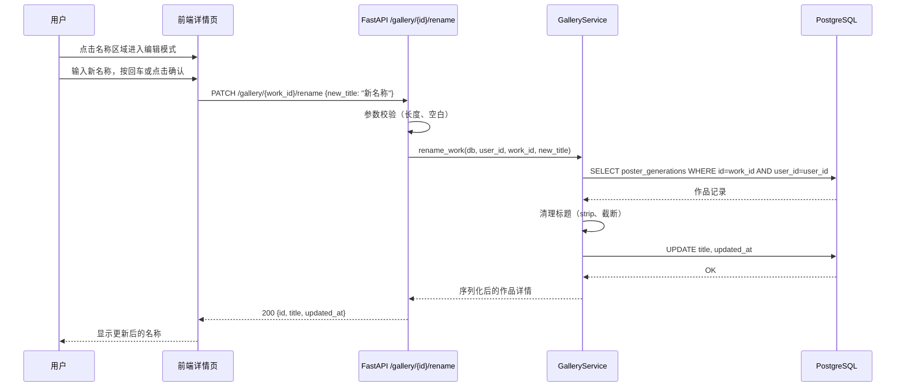

# Design Document: Gallery Image Rename

## Overview

为作品库（Gallery）中的图片添加重命名功能，允许用户在图片详情页修改作品名称。当前系统已有 `PUT /gallery/{work_id}` 接口支持更新标题和标签，后端逻辑已具备。本功能的核心在于：

1. 提供一个专用的重命名 API 端点（`PATCH /gallery/{work_id}/rename`），语义更清晰、权限更精细
2. 前端在图片详情页增加可编辑的名称区域，支持点击编辑、内联修改、即时保存
3. 对名称进行合理的校验（长度限制、空白处理、特殊字符过滤）

该功能复用现有的 `PosterGeneration.title` 字段，无需数据库迁移。

## Architecture

```mermaid
graph TD
    A[前端 - 图片详情页] -->|PATCH /gallery/{id}/rename| B[FastAPI Router]
    B --> C[GalleryService.rename_work]
    C --> D[PostgreSQL - poster_generations.title]
    C --> E[返回更新后的作品详情]
    E --> B
    B --> A
```

### 请求流程



## Components and Interfaces

### 组件 1：API 路由层（`app/api/v1/gallery.py`）

**职责**：
- 接收重命名请求，校验输入参数
- 调用 Service 层执行业务逻辑
- 返回标准化响应或错误

**接口**：

```python
class RenameWorkRequest(BaseModel):
    """重命名请求体"""
    new_title: str = Field(
        ...,
        min_length=1,
        max_length=200,
        description="新的作品名称，1-200 个字符"
    )

class RenameWorkResponse(BaseModel):
    """重命名响应体"""
    id: str
    title: str
    updated_at: str


@router.patch(
    "/{work_id}/rename",
    response_model=RenameWorkResponse,
    summary="重命名作品",
)
async def rename_gallery_work(
    work_id: UUID,
    request: RenameWorkRequest,
    current_user: User = Depends(get_current_user),
    db: AsyncSession = Depends(get_async_session),
) -> RenameWorkResponse:
    ...
```

### 组件 2：服务层（`app/services/gallery_service.py`）

**职责**：
- 验证作品归属权（只能重命名自己的作品）
- 清理和规范化标题文本
- 更新数据库记录
- 返回更新后的完整作品信息

**接口**：

```python
async def rename_work(
    self,
    db: AsyncSession,
    *,
    user_id: UUID,
    work_id: UUID,
    new_title: str,
) -> Optional[dict[str, Any]]:
    """
    重命名作品。

    返回更新后的作品序列化字典，若作品不存在或不属于当前用户则返回 None。
    """
    ...
```

### 组件 3：前端交互（描述性）

**职责**：
- 在图片详情页名称区域显示编辑图标
- 点击后切换为内联输入框，预填当前名称
- 支持回车确认、Escape 取消
- 调用 API 后更新本地状态

## Data Models

### 现有模型：PosterGeneration

```python
class PosterGeneration(Base):
    __tablename__ = "poster_generations"

    id = Column(UUID(as_uuid=True), primary_key=True)
    user_id = Column(UUID(as_uuid=True), ForeignKey("users.id"))
    title = Column(String(200), nullable=True)  # ← 重命名目标字段
    updated_at = Column(DateTime(timezone=True))
    # ... 其他字段
```

**校验规则**：
- `title` 长度：1-200 个字符（去除首尾空白后）
- 不允许纯空白字符串
- 自动去除首尾空白
- 保留原有标题（若新标题清理后为空则拒绝更新）

## Key Functions with Formal Specifications

### 函数 1：rename_work()

```python
async def rename_work(
    self,
    db: AsyncSession,
    *,
    user_id: UUID,
    work_id: UUID,
    new_title: str,
) -> Optional[dict[str, Any]]:
    """重命名作品标题。"""
    work = await self._get_owned_work(db, user_id=user_id, work_id=work_id)
    if not work:
        return None

    cleaned_title = new_title.strip()
    if not cleaned_title:
        return None  # 空标题不允许

    work.title = cleaned_title[:200]
    work.updated_at = datetime.utcnow()
    await db.flush()

    return {
        "id": str(work.id),
        "title": work.title,
        "updated_at": work.updated_at.isoformat(),
    }
```

**前置条件（Preconditions）**：
- `user_id` 是有效的已认证用户 ID
- `work_id` 是有效的 UUID
- `new_title` 是非空字符串（由 Pydantic 在 API 层保证 `min_length=1`）

**后置条件（Postconditions）**：
- 若作品存在且属于当前用户：`work.title == new_title.strip()[:200]`，`work.updated_at` 已更新
- 若作品不存在或不属于当前用户：返回 `None`，数据库无变更
- 不影响作品的其他字段（tags、image_url 等）

**循环不变量（Loop Invariants）**：N/A（无循环）

### 函数 2：rename_gallery_work()（API 端点）

```python
@router.patch("/{work_id}/rename", response_model=RenameWorkResponse)
async def rename_gallery_work(
    work_id: UUID,
    request: RenameWorkRequest,
    current_user: User = Depends(get_current_user),
    db: AsyncSession = Depends(get_async_session),
) -> RenameWorkResponse:
    result = await gallery_service.rename_work(
        db,
        user_id=current_user.id,
        work_id=work_id,
        new_title=request.new_title,
    )
    if not result:
        raise HTTPException(
            status_code=status.HTTP_404_NOT_FOUND,
            detail="作品不存在或无权修改",
        )
    return RenameWorkResponse(**result)
```

**前置条件（Preconditions）**：
- 请求已通过认证（`get_current_user` 依赖）
- `work_id` 是有效的 UUID 路径参数
- `request.new_title` 满足 `1 <= len <= 200`

**后置条件（Postconditions）**：
- 成功：返回 HTTP 200 + `{id, title, updated_at}`
- 作品不存在：返回 HTTP 404 + `{"detail": "作品不存在或无权修改"}`
- 参数校验失败：返回 HTTP 422（Pydantic 自动处理）

## Algorithmic Pseudocode

### 重命名主流程

```pascal
ALGORITHM renameWork(user_id, work_id, new_title)
INPUT: user_id (UUID), work_id (UUID), new_title (String)
OUTPUT: RenameResult 或 Error

BEGIN
  // Step 1: 权限验证 - 查找属于当前用户的作品
  work ← DB.SELECT FROM poster_generations
          WHERE id = work_id AND user_id = user_id

  IF work IS NULL THEN
    RETURN Error(404, "作品不存在或无权修改")
  END IF

  // Step 2: 标题清理
  cleaned_title ← TRIM(new_title)

  IF LENGTH(cleaned_title) = 0 THEN
    RETURN Error(422, "标题不能为空")
  END IF

  IF LENGTH(cleaned_title) > 200 THEN
    cleaned_title ← SUBSTRING(cleaned_title, 0, 200)
  END IF

  // Step 3: 持久化更新
  work.title ← cleaned_title
  work.updated_at ← NOW()
  DB.FLUSH()

  // Step 4: 返回结果
  RETURN {
    id: work.id,
    title: work.title,
    updated_at: work.updated_at
  }
END
```

## Example Usage

```python
# 示例 1：成功重命名
import httpx

response = httpx.patch(
    "http://localhost:8000/api/v1/gallery/550e8400-e29b-41d4-a716-446655440000/rename",
    json={"new_title": "16届本科毕业设计"},
    headers={"Authorization": "Bearer <token>"},
)
assert response.status_code == 200
data = response.json()
assert data["title"] == "16届本科毕业设计"
assert "updated_at" in data


# 示例 2：作品不存在
response = httpx.patch(
    "http://localhost:8000/api/v1/gallery/00000000-0000-0000-0000-000000000000/rename",
    json={"new_title": "新名称"},
    headers={"Authorization": "Bearer <token>"},
)
assert response.status_code == 404


# 示例 3：标题过长（Pydantic 校验拒绝）
long_title = "A" * 300
response = httpx.patch(
    "http://localhost:8000/api/v1/gallery/550e8400-e29b-41d4-a716-446655440000/rename",
    json={"new_title": long_title},
    headers={"Authorization": "Bearer <token>"},
)
assert response.status_code == 422


# 示例 4：纯空格标题
response = httpx.patch(
    "http://localhost:8000/api/v1/gallery/550e8400-e29b-41d4-a716-446655440000/rename",
    json={"new_title": "   "},
    headers={"Authorization": "Bearer <token>"},
)
# 通过 Pydantic min_length 检查但 service 层拒绝纯空格
assert response.status_code == 404
```

## Correctness Properties

*属性是系统在所有有效执行中应保持为真的特征或行为——本质上是关于系统应该做什么的形式化陈述。属性作为人类可读规范与机器可验证正确性保证之间的桥梁。*

### Property 1: 重命名后标题一致性

*For any* 属于当前用户的作品和任意有效标题（去除首尾空白后长度在 1-200 之间），重命名后作品标题应等于 `strip(new_title)[:200]`。

**Validates: Requirements 1.1, 2.3, 2.4**

### Property 2: 纯空白标题拒绝

*For any* 仅由空白字符组成的字符串（空格、制表符、换行符等），提交为新标题时系统应拒绝该请求，作品标题保持不变。

**Validates: Requirements 2.1**

### Property 3: 超长标题拒绝

*For any* 长度超过 200 个字符的字符串，提交为新标题时 API 层应返回 HTTP 422 校验错误。

**Validates: Requirements 2.2**

### Property 4: 权限隔离

*For any* 属于用户 A 的作品和任意不同于用户 A 的用户 B，用户 B 尝试重命名该作品时应返回失败（None），数据库无变更。

**Validates: Requirements 3.1**

### Property 5: 不影响其他字段

*For any* 作品和任意有效标题，执行重命名后作品的标签、图片 URL、模式等其他字段应保持不变。

**Validates: Requirements 4.1**

### Property 6: 幂等性

*For any* 作品和任意有效标题，对同一作品连续执行两次相同的重命名操作，两次结果的标题应完全一致。

**Validates: Requirements 4.2**

## Error Handling

### 错误场景 1：作品不存在

**条件**：`work_id` 对应的记录不存在于数据库中
**响应**：HTTP 404，`{"detail": "作品不存在或无权修改"}`
**恢复**：前端提示用户刷新页面，可能作品已被删除

### 错误场景 2：无权修改（非作品所有者）

**条件**：作品存在但 `user_id` 不匹配
**响应**：HTTP 404，`{"detail": "作品不存在或无权修改"}`（统一为 404 避免信息泄露）
**恢复**：前端提示无权操作

### 错误场景 3：标题校验失败

**条件**：`new_title` 为空字符串或超过 200 字符
**响应**：HTTP 422，Pydantic 标准校验错误格式
**恢复**：前端在提交前进行客户端校验，显示字符计数

### 错误场景 4：并发冲突

**条件**：两个请求同时修改同一作品标题
**响应**：最后写入者胜出（last-write-wins），无需特殊处理
**恢复**：前端可在保存后刷新显示最新标题

## Testing Strategy

### 单元测试

- 测试 `rename_work` 方法的正常路径（成功重命名）
- 测试作品不存在时返回 None
- 测试非所有者无法重命名
- 测试标题清理逻辑（首尾空白、截断）
- 测试空标题被拒绝

### 属性测试

**测试库**：hypothesis

- 标题一致性属性：任意有效标题重命名后，读取结果应一致
- 幂等性属性：重复重命名结果不变
- 权限隔离属性：随机用户无法修改他人作品

### 集成测试

- 完整 HTTP 请求测试（认证 → 重命名 → 验证响应）
- 与现有 `PUT /gallery/{work_id}` 接口的兼容性测试
- 并发重命名测试

## Security Considerations

- **权限控制**：仅作品所有者可重命名，通过 `user_id` 匹配实现
- **信息隐藏**：非所有者访问返回 404 而非 403，避免暴露作品存在性
- **输入清理**：标题长度限制 200 字符，防止存储滥用
- **XSS 防护**：标题在前端渲染时应进行转义（前端责任）

## Dependencies

- **现有依赖**（无需新增）：
  - FastAPI + Pydantic（API 层）
  - SQLAlchemy（ORM）
  - PostgreSQL（数据库）
  - 现有认证中间件（`get_current_user`）
